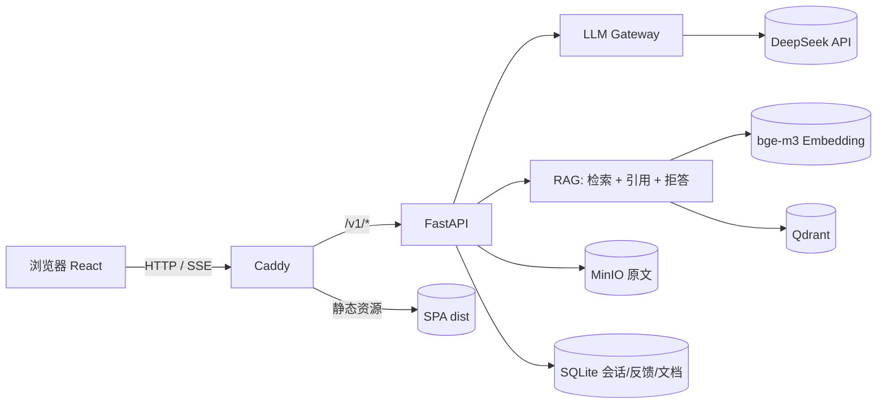

# WorkPilot

> 可私有部署的研发知识 AI 助手：导入团队文档，给出**带段落引用**的答案，知识不足时**明确拒答**；自带评测与一键部署。

> **WorkPilot** is a self-hostable knowledge assistant for engineering teams: ingest team docs, answer with paragraph-level citations, and explicitly refuse when it lacks grounding — with built-in evals and one-command deployment.

 <!-- Day31 替换为真实演示录屏 -->

[快速开始](#快速开始) · [架构](docs/architecture.md) · [评测报告](eval/reports/) · [设计决策](docs/adr/) · [运行手册](docs/runbook.md)

## 功能

- 文档上传（md / pdf / html / txt）→ 异步解析、分块、向量化，状态可见
- 流式问答 + 段落级引用溯源 + 库外拒答
- 会话历史、👍/👎 + 原因反馈 → 一键导出为评测 badcase
- 50 题评测集：检索指标 + LLM-as-a-judge，报告入库可追溯
- Docker Compose + Caddy 一键部署，健康检查、request_id 日志、备份恢复

## 架构



完整组件图、问答链路（sequenceDiagram）与数据模型（erDiagram）见 [docs/architecture.md](docs/architecture.md)。

## 评测结果

50 题评测集（库内 30 / 库外 20），数字全部可追溯到报告：

| 指标 | 基线 v0.2 | 当前 v0.3 | 目标 |
| --- | ---: | ---: | --- |
| hit@5 | [0.921](eval/reports/20261023-rag-baseline.md) | [0.921](eval/reports/20261028-rag-v0.3.md) | ≥ 0.85 |
| 引用正确率 | 待测 | [1.000](eval/reports/20261028-rag-v0.3.md) | ≥ 0.80 |
| 库外拒答正确率 | [1.000](eval/reports/20261023-rag-baseline.md) | [1.000](eval/reports/20261028-rag-v0.3.md) | ≥ 0.80 |
| P95 延迟 | [2280 ms](eval/reports/20261023-rag-baseline.md) | [2708 ms](eval/reports/20261028-rag-v0.3.md) | < 8 s |
| 单次成本 | [¥0.0008](eval/reports/20261023-rag-baseline.md) | [¥0.0020](eval/reports/20261028-rag-v0.3.md) | < ¥0.02 |

补充指标（同两份报告）：MRR 0.789 / 0.789；库内误拒率 0.132 → 0.053；正确性均值 0.85、忠实度 1.0（v0.3，LLM-as-a-judge）。早期 20 题种子集见 [eval/reports/20261022-rag-v0.2.md](eval/reports/20261022-rag-v0.2.md)。

完整复盘：[docs/portfolio/p1.md](docs/portfolio/p1.md)。

## 快速开始

```bash
git clone <repo-url> && cd workpilot
cp .env.example .env   # 填写 LLM_API_KEY 等（见注释）
make up && make seed   # 打开 http://localhost:8080
```

## 前置条件

- Docker Desktop
- Embedding 使用本机 Ollama（`ollama pull bge-m3`）或在 .env 中改为 SiliconFlow

## 技术栈

| 层 | 技术 |
| --- | --- |
| 前端 | React 18 + Vite 8 + Tailwind CSS 4 |
| 后端 | Python 3.12+ + FastAPI + uvicorn |
| LLM | DeepSeek（问答，默认）/ bge-m3（Embedding，本机 Ollama 或 SiliconFlow） |
| 向量库 | Qdrant（单容器 + payload 过滤 + 快照） |
| 对象存储 | MinIO（原始文档） |
| 业务库 | SQLite（会话 / 反馈 / 文档，W19 换 Postgres） |
| 反代 / 部署 | Caddy + Docker Compose |

## 设计决策

5 篇 ADR，一篇一个决策，含当时约束与放弃方案：

- [0001 · LLM 供应商与网关](docs/adr/0001-llm-gateway.md)：DeepSeek 默认，自建 OpenAI 兼容网关（超时 / 重试 / 计量）
- [0002 · 向量库选 Qdrant](docs/adr/0002-qdrant.md)：单容器、payload 过滤、hybrid、快照
- [0003 · 分块与检索参数](docs/adr/0003-chunking-retrieval.md)：chunk 600 / overlap 100 / dense / top_k 5 / 阈值 0.52
- [0004 · 手写 RAG](docs/adr/0004-handwritten-rag.md)：不用 LangChain，loaders → chunking → embedding → retrieve → answer 全手写
- [0005 · Compose + Caddy 部署](docs/adr/0005-compose-caddy.md)：单机 Compose，Caddy 反代 + basic auth，IP + HTTP

## 路线图

| 里程碑 | 内容 |
| --- | --- |
| v0.5 | Knowledge 云端可访问（当前） |
| v1.0 | Tools / Agent / Memory / HITL / MCP / Agent Eval |
| v2.0 | 场景包 / 多空间 / 安全 / 回归 / 在线 Demo |

## License

MIT
