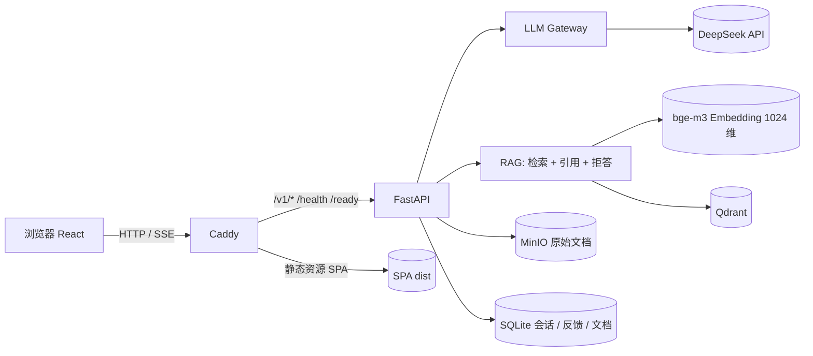
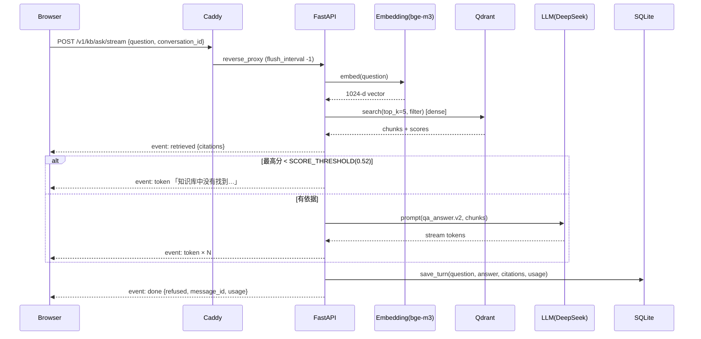
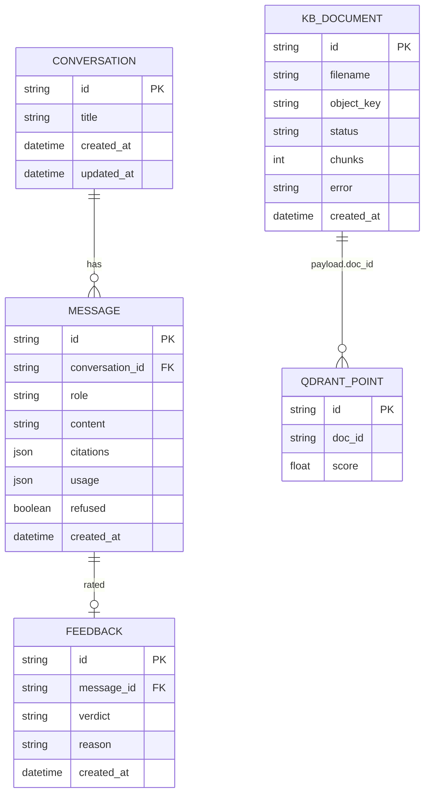

# Architecture

WorkPilot 一次问答请求的组件、链路与数据模型。三张图分别是组件图（flowchart）、
问答链路（sequenceDiagram）、数据模型（erDiagram），可在 VS Code / GitHub / Gitea
的 Markdown 预览中直接渲染。

## 1. 组件图

- **Caddy**：单入口。静态资源（SPA dist）走 `file_server`；`/v1/*`、`/health`、
  `/ready` 反代到 FastAPI，SSE 用 `flush_interval -1` 逐 token 下发不缓冲。
- **LLM Gateway**：OpenAI 兼容协议，统一超时 / 重试 / 错误映射 / 成本计量
  （ADR 0001）；默认 DeepSeek，`LLM_PROVIDER` 切换。
- **RAG**：loaders → chunking → embedding → retrieve → answer 全手写（ADR 0004）。
- **Embedding**：`bge-m3`（1024 维）。dev 用本机 Ollama，prod 用 SiliconFlow
  （同模型，`EMBEDDING_BASE_URL` 区分）。
- **Qdrant**：向量 + payload，快照备份（ADR 0002）。
- **MinIO**：原始文档对象存储（S3 兼容）。
- **SQLite**：文档 / 会话 / 反馈业务库（W19 换 Postgres）。

### dev / prod 差异

| 项 | dev（`deploy/docker-compose.yml`） | prod（`deploy/docker-compose.prod.yml`） |
| ---- | ---- | ---- |
| 入口 | `localhost:8080`，无鉴权 | `8.148.216.61:80`，Caddy `basic_auth` |
| Embedding | 本机 Ollama（`host.docker.internal:11434`） | SiliconFlow `https://api.siliconflow.cn/v1` |
| qdrant / minio | 暴露端口便于调试 | 只在 compose 内网可达，不暴露公网 |
| TLS | 无 | 无（IP + HTTP，域名/TLS 留作后续，见 ADR 0005） |

## 2. 问答链路（sequenceDiagram）

- **`retrieved` 事件先于 LLM 调用**：先把引用给前端，用户在等待生成时已能看到依据，
  降低感知延迟，也支持「最高分低于阈值 → 拒答」分支（不调 LLM 直接返回拒答）。
- 检索默认 `dense`、`top_k=5`、`SCORE_THRESHOLD=0.52`；分块 `chunk_size=600`、
  `chunk_overlap=100`（这些是 W5 评测校准的真实值，见 ADR 0003）。
- 结束后 `save_turn` 落库（问题 / 答案 / 引用 / usage），供会话历史与评测导出。

## 3. 数据模型（erDiagram）

### Qdrant payload 字段

向量点（chunk）的 payload 记录溯源与展示所需字段：

| 字段 | 说明 |
| ---- | ---- |
| `doc_id` | 归属文档 id（对应 `KB_DOCUMENT.id`） |
| `title` | 文档标题 |
| `section` | 分块所属的标题层级 |
| `chunk_index` | 文档内分块序号 |
| `text` | 分块正文（引用展示用） |

- `CONVERSATION` / `MESSAGE` / `FEEDBACK` / `KB_DOCUMENT` 存 SQLite
  （`apps/api/app/db/models.py`）；向量与 payload 存 Qdrant，二者以
  `doc_id` 关联，检索命中后按 `payload.doc_id` 回查原文与元数据。
